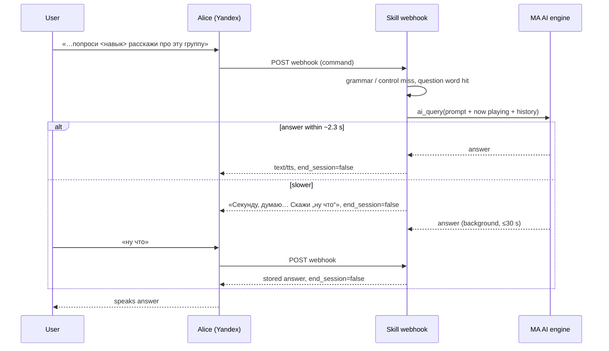

## Problem Statement

Every phrase the skill does not recognize as a command is treated as a music
search. A question such as "Алиса, попроси <навык> расскажи про эту группу"
or "почему небо голубое" ends in "Не нашёл такую музыку: …" or, worse,
starts radio for a random match. Music Assistant already exposes AI engines
(`ProviderFeature.AI_QUERY` plugin providers such as OpenAI-compatible), but
the skill cannot use them.

## Solution Summary

An opt-in "AI answers" setting (off by default) plus an AI-engine selector
built from Music Assistant's shared engine helpers. When enabled and an
engine is available, phrases that start with a question or conversational
word ("кто", "что такое", "почему", "как", "сколько", "расскажи",
"объясни", …) are sent to the selected engine instead of the music search.
Commands handled earlier (grammar intents, playback control, "что играет")
are unaffected. The prompt carries a hard-coded Russian system prompt, the
track currently playing on the user's player (the last-used or preferred
player, else the single playing exposed player), and the last three question/answer pairs of
the skill session (kept in memory, 5-minute TTL).

After an AI answer the session stays open and the next turn is treated as a
follow-up: it goes to the engine even without a question word, unless it starts
with a play verb ("включи", "поставь", "играй"), which routes it to the music
search as today. Any turn handled outside the AI path ends the conversation
mode, so later bare queries search music again. A goodbye ("хватит",
"спасибо") ends the session. Phrases Yandex matched to a control intent
("дальше", "пауза") are never treated as "ну что".

Alice must get a webhook reply within 3 seconds. The skill waits up to
~2.3 s for the engine; if the answer is late it replies "Секунду, думаю…
Скажи «ну что»", keeps the query running in the background (30 s cap), and
returns the answer on the next short follow-up ("ну что", "и?", "готово?").
Any other phrase cancels the pending query and is processed normally.
Answers are stripped of markdown and emoji, cut at a sentence boundary to fit
Alice's length limit, and get the usual TTS pronunciation hints.

Out of scope for v1: an explicit "спроси у ИИ" prefix, tool calling (the AI
controlling Music Assistant), speaking through a Yandex Station
(`yandex_station/say`), and an editable system prompt.

## Acceptance Criteria

1. With the setting off (default), or with no AI engine available, every
   phrase is handled exactly as before — question-like phrases still go to
   the music search.
2. With the setting on and an engine selected, a phrase starting with a
   question/conversational word is answered with the engine's reply; the
   music search is not called; the session is left open.
3. Playback control and "что играет" phrases keep their current handling
   even when they start with a question word.
4. The turn right after an AI answer, without a question word, is sent to
   the engine together with the previous turns (at most three pairs); one
   starting with a play verb starts music as today; after a non-AI turn,
   bare queries search music again.
5. An engine answer slower than the inline budget produces the "думаю"
   reply; a following short follow-up returns the finished answer, or
   "ещё думаю" while it is still running (at most twice); any other phrase
   cancels the pending query.
6. An engine error or a 30 s timeout produces "Не получилось получить
   ответ, попробуй спросить иначе." — never HTTP 500 or silence.
7. The answer sent to Alice contains no markdown or emoji and does not
   exceed Alice's text/tts length limit; it is cut at a sentence boundary.
8. The prompt includes the currently playing track when a player can be
   determined, and omits it otherwise.
9. Question/answer text is logged only at DEBUG level and truncated.
10. Within an AI conversation, a goodbye («хватит», «спасибо», «пока») ends
    the session without querying the engine.

## Test Plan

- Unit tests for the trigger heuristic: question words match, music
  requests ("включи как дела" style titles with a play verb) do not.
- Unit tests for answer sanitizing: markdown, emoji, length cut at a
  sentence boundary.
- Webhook tests (existing `tests/test_dialogs.py` harness) with a fake AI
  engine: setting off → search; on → answer + open session; control phrase
  → control; follow-up uses history; play verb inside conversation →
  search; slow engine → "думаю" then answer on "ну что"; still running →
  "ещё думаю"; other phrase cancels; engine error → fallback text.
- Config test: the AI settings appear in the settings block and depend on
  the toggle.
- Manual: enable with an OpenAI-compatible engine, ask a question on a
  Yandex Station, verify spoken answer and follow-up.

## Sequence Diagram

