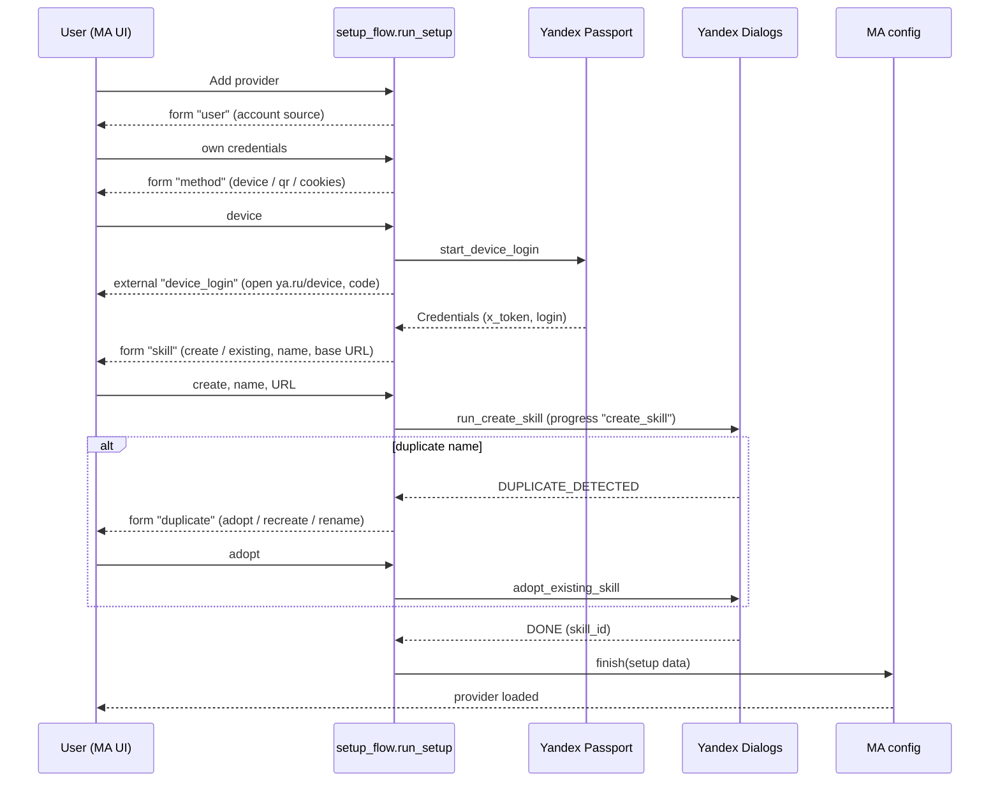

## Problem Statement

Since Music Assistant 2.10 (upstream #5017) a provider's options page is built
by the instance method `get_config_entries()` and buttons are handled by
`handle_config_action(action)`; neither receives the unsaved form values. The
module-level `get_config_entries(mass, instance_id, action, values)` this
provider is built on is no longer called, so on MA 2.10/2.11 the whole options
page — sign-in, skill creation, editing, manifest tools — does not work.

On top of that `dev` pins `ya-passport-auth` 2.x while the sign-in code still
uses the 1.x hosted device-code page (`DevicePageConfig`, `run_device_flow`),
which 2.0.0 removed; the provider fails to import. The sibling Yandex providers
(Music, Station, SmartHome) already moved one-time input into MA's interactive
setup flow and pin `ya-passport-auth[ma]==2.2.0`; in a shared MA environment a
different pin would conflict.

## Solution Summary

Target MA 2.11. A new `setup_flow.py` (`run_setup(session)`) runs when the
provider is added and on *Reconfigure*:

1. **Account** — borrow a linked Yandex Music instance or use own credentials.
2. **Sign-in** (own credentials) — Device code, QR code (rendered with
   `segno`) or browser cookies, through `PassportClient` /
   `ya_passport_auth.ma.login_with_cookies`; the device step is an external
   "open ya.ru/device" step showing the code. A denied login aborts the flow.
3. **Skill** — "Create automatically" (skill name + public HTTPS base URL,
   pre-filled from MA's webserver settings and validated) or "I already have
   a skill" (skill id; the flow shows the webhook URL to paste in the Yandex
   console).
4. **Create** — the existing pipeline runs as a progress step. A duplicate
   name offers Adopt / Recreate / Rename (back to step 3); a failure returns
   to step 3 with the error.
5. **Finish** — tokens, skill id, webhook secret, artifacts and publication
   status are stored as setup data.

On reconfigure the first step is a menu: sign in again, edit the skill (name,
up to three extra activation phrases, voice; pushed to Yandex), change the base
URL or regenerate the webhook secret (re-registers the backend), or create the
skill again. When MA starts the reconfigure because of an auth error, the menu
is skipped and the sign-in step opens directly. Runtime credential failures
raise `LoginFailed`, so MA marks the provider *authentication required*.

The options page keeps plain options (voice-controllable players, instance name
override, voice continuation), a status block (account, skill id, publication
status, diagnostics) and buttons that need no input: Test webhook, Refresh
status, Open developer console (URL result), Delete skill, and the manifest
Export / Import / Reset / Validate (Import reads the saved paste field, so
the user saves first, then presses Import).

Existing installs keep working: on load, auth and skill keys still stored as
plain config values are copied once into setup data.

## Acceptance Criteria

1. The provider imports and loads on MA 2.11 with `ya-passport-auth[ma]==2.2.0`;
   `auth_page.py` and every `ya_passport_auth` 1.x API are gone.
2. Adding the provider runs the setup flow: account source → (own) sign-in by
   device code, QR code or cookies → skill step → creation → finish; borrowing
   skips sign-in and uses the linked instance's x_token read-only.
3. The device step shows the code with an "Open ya.ru/device" button, the QR
   step shows the QR image; both mint a fresh code when one expires; a login
   denied in Yandex aborts with a localized reason.
4. "I already have a skill" finishes with the entered skill id and shows the
   webhook URL; no Yandex Dialogs API call is made.
5. A duplicate skill name offers Adopt, Recreate and Rename; Adopt and Recreate
   finish with the resulting skill id; Rename returns to the skill step.
6. An invalid (non-public or non-HTTPS) base URL is rejected on the skill step
   before any API call.
7. Reconfigure shows the menu; each item runs only its part and finishes; a
   reconfigure started for an auth error opens sign-in directly.
8. The options page renders from saved config and setup data only; every
   remaining button works through `handle_config_action` and reports its
   outcome; no entry depends on unsaved form values.
9. A rejected x_token during an options action raises `LoginFailed`.
10. A provider configured before this change (tokens, skill id, artifacts in
    config values) loads, answers webhooks, and has those keys copied into
    setup data.
11. Every flow step, option, error and abort reason has text in
    `strings.json`.

## Test Plan

- `tests/test_setup_flow.py` with a scripted fake session (Station pattern)
  plus one run on a real `SetupSession`: borrow path; device / QR / cookie
  sign-in incl. code refresh on expiry and denied login; manual skill id;
  auto-create DONE; duplicate → adopt / recreate / rename; failure → retry;
  invalid base URL; reconfigure menu items; auth-reason shortcut.
- `tests/test_plugin.py`: legacy-config migration into setup data; options
  page entries per state; each action through `handle_config_action`
  (Yandex HTTP mocked per `tests/test_auto_create.py`); `LoginFailed` on a
  rejected token.
- `tests/test_config_strings.py` adapted: every entry and flow step resolves
  text.
- Manual on MA 2.11: add provider with device code, QR and cookies; create a
  skill; reconfigure → edit skill; Test webhook; upgrade an existing install.

## Sequence Diagram

## Data Model

Setup data (encrypted where secret) — **new location** for keys that were
plain config values:

| Key | Type | Notes |
|---|---|---|
| `ym_instance` | str | `__own__` or linked Yandex Music instance id (moved) |
| `auth_x_token` | secret str | own credentials only; absent while borrowing (moved) |
| `auth_user_name` | str | display login for the status block (moved) |
| `dialog_skill_id` | str | (moved) |
| `dialog_skill_name` | str | (moved) |
| `dialog_webhook_secret` | secret str | (moved) |
| `external_base_url` | str | (moved) |
| `dialog_activation_phrase_2..4`, `dialog_skill_voice` | str | (moved) |
| `dialog_auto_create_artifacts` | str (JSON) | (moved) |
| `dialog_publication_status` | str | (moved) |

Config values (options page): `exposed_players`, `use_different_instance_name`,
`instance_name`, `dialog_voice_continuation`, `dialog_skill_override_paste`.

Removed: `pending_duplicate_skill_id/name`, `edit_mode` (the flow holds
this state) and `dialog_skill_token` (never used at runtime), and the actions Sign in, Sign out, Create skill, Cancel, Rename,
Revert name, Edit / Update / Cancel edit, Regenerate secret, Adopt and
Recreate (all now flow steps).
